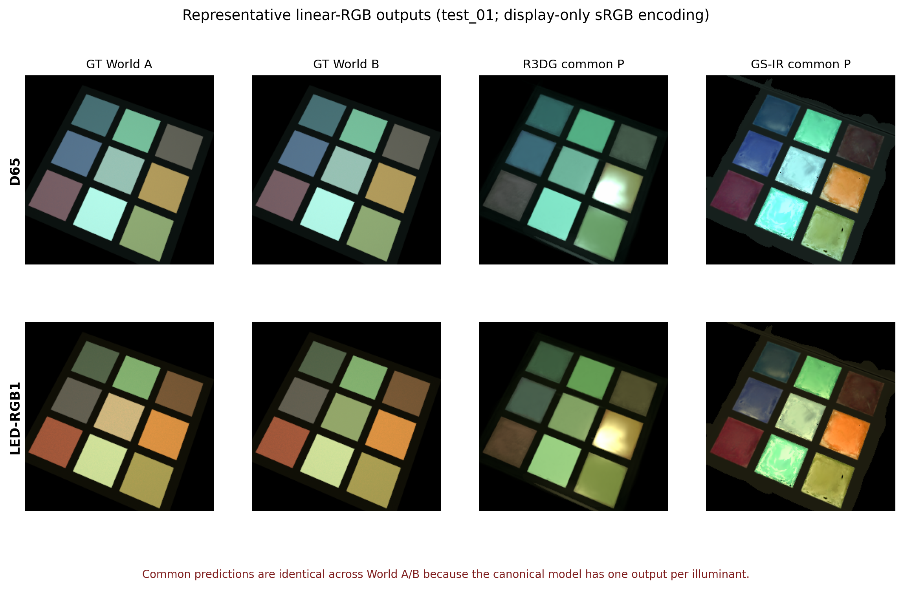
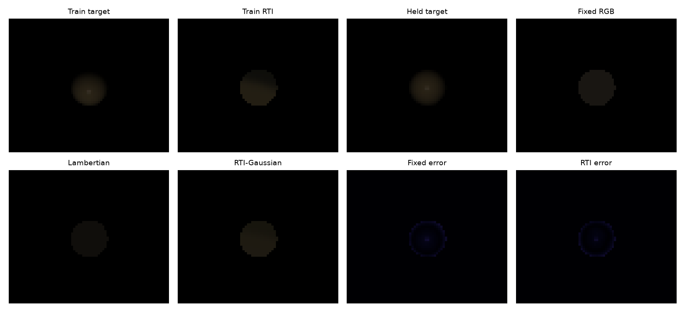
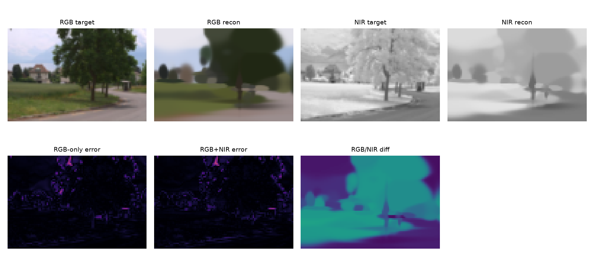
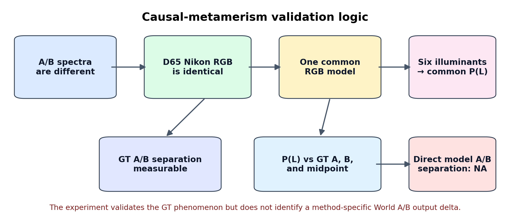
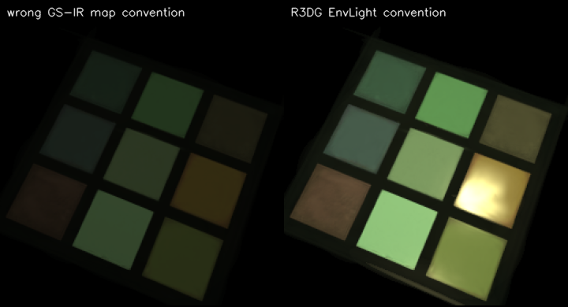
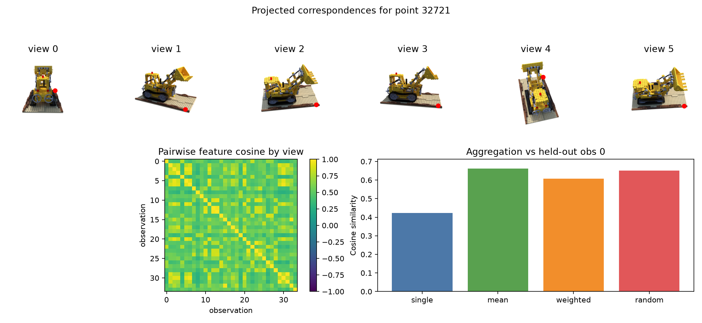
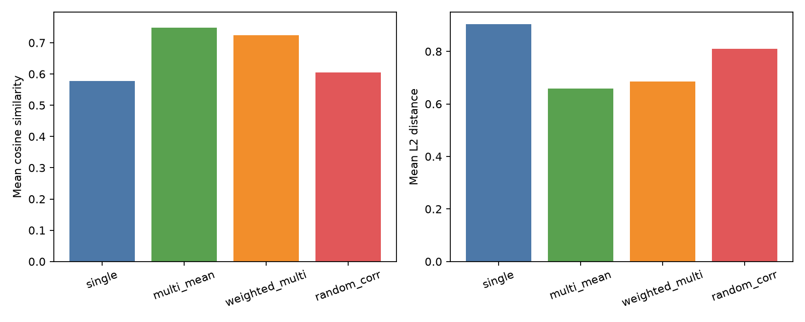

# Optical Research

**Gaussian 표현의 조명 반응, RGB/NIR 단서, 메타머리즘과 다중시점 특징을 탐색하는 연구.**

보이는 RGB를 넘어 새로운 조명에서의 외관을 설명하기 위해, 속성 모델 실험과 분광 정답 비교를 단계별로 진행했습니다. 현재 저장소는 실험 코드·그림·수치와 분광 3DGS 확장 제안을 함께 정리한 연구 기록입니다.

[연구 구성](#연구-구성) · [실험 결과](#실험-결과) · [다음 단계](#다음-단계) · [코드와-재현](#코드와-재현) · [상세 연구 기록](RESEARCH_DETAILS.md)

**같은 입력 RGB, 다른 조명 반응.** D65와 LED-RGB1 아래의 World A/B 분광 정답, 그리고 R3DG·GS-IR의 공통 예측을 비교합니다. 각 방법이 두 세계를 각각 복원한 결과는 아닙니다.

## 연구 구성

| 실험 | 질문 | 검증 범위 |
|---|---|---|
| RTI-Gaussian | 고정 색 대신 조명 반응을 저장하면? | DiLiGenT ball의 2D Gaussian 파일럿 |
| RGB-NIR Gaussian | 같은 공간 구조에 다른 파장대를 담으면? | EPFL RGB/NIR 한 페어 재구성 |
| 메타머리즘 | 같은 RGB에서 새 조명의 정답을 결정할 수 있는가? | 합성 분광 정답과 RGB 모델 비교 |
| 다중시점 특징 | 같은 3D 위치의 관측을 모으면 더 일관적인가? | Lego의 RGB CNN 특징 집계 |
| 분광 3DGS 확장 | 여러 스펙트럼 후보와 불확실성을 유지할 수 있는가? | 설계 제안, 전체 통합은 미검증 |

아래 수치는 2026-09-16에 기존 코드와 산출물을 대조한 기록입니다. 실험마다 입력과 평가 범위가 다르며, 하나의 완성된 분광 3DGS 성능으로 합산하지 않습니다.

## 실험 결과

### 1. 조명 반응을 저장하는 RTI-Gaussian

DiLiGenT ball · 24조명 · 96개 2D Gaussian · 100 iteration. 표시된 지표는 **첫 홀드아웃 조명 하나**의 결과입니다.

| 모델 | MAE ↓ | PSNR ↑ |
|---|---:|---:|
| Fixed RGB | 0.028975 | 28.9196 dB |
| Lambertian | 0.036233 | 27.0825 dB |
| RTI | 0.026276 | 29.4450 dB |

RTI의 MAE는 Fixed RGB보다 약 9.32% 작았습니다. 전체 홀드아웃 평균이나 물리 BRDF 복원을 입증한 결과는 아닙니다. [수치](evidence/pilot/results/rti_gaussian/metrics.json) · [구현](evidence/pilot/source/experiment_rti_gaussian.py)

### 2. RGB와 NIR를 공유하는 Gaussian

EPFL `country_0000.jpg` 한 페어에서 공간 기저를 공유하고 RGB·NIR 속성을 따로 학습했습니다.

| 평가 | MAE ↓ |
|---|---:|
| RGB-only의 RGB 재구성 | 0.034878 |
| RGB+NIR의 RGB 재구성 | 0.034175 |
| RGB+NIR의 NIR 재구성 | 0.036244 |

RGB 재구성 MAE는 약 2.02% 작았습니다. 학습 페어의 재구성 결과이며 재질 분류나 새 장면 일반화 평가는 아닙니다. [수치](evidence/pilot/results/rgb_nir_gaussian/metrics.json)

### 3. 메타머리즘과 재조명

서로 다른 스펙트럼이 source RGB에서 같게 관측되는 World A/B를 만들고, 새 조명에서 갈라지는 정답을 비교합니다. RGB 관측만으로 유일한 스펙트럼을 결정하기 어려운 조건을 다룹니다.

**조명 좌표계 진단.** 환경맵 convention을 교정하면 외관이 크게 달라집니다. 유한 면적 광원과 proxy의 차이, 노출·clamp·좌표계를 모델 오차와 구분해야 합니다. 현재 모델 분리 판정은 **INCONCLUSIVE**이며 우열을 확정하지 않습니다. [실험 근거](evidence/metamerism) · [시각 기록](evidence/metamerism/visual-history/README.md)

### 4. 다중시점 특징 집계

알려진 Lego 카메라 pose와 3D 위치로 관측을 모읍니다. 위 그림은 점 32721의 투영과 특징 일치도를 보여줍니다.

| 방법 | held-out cosine ↑ | L2 ↓ |
|---|---:|---:|
| Single-view | 0.577799 | 0.904653 |
| Multi-view mean | **0.748193** | **0.658599** |
| Weighted multi-view | 0.724858 | 0.684736 |
| Random correspondence | 0.604918 | 0.809914 |

36뷰 · 1,800점 · 44,304 leave-one-out 관측에서 단순 평균이 가장 높았습니다. 평가 대상은 RGB CNN 특징이며 분광 복원 정확도가 아닙니다. Random 대조는 관측 수까지 통제된 비교가 아니므로 개선 전부를 3D 대응의 효과로 해석하지 않습니다. [집계 CSV](evidence/multiview/results/summary.csv) · [재검산](evidence/review/aggregation-audit.json)

## 다음 단계

[Multi-view Spectrum 제안](evidence/reports/multiview-spectrum-proposal.pdf)은 Gaussian별 스펙트럼 후보와 상대 가중치를 유지하고, 재조명 결과의 불확실성을 함께 표현하는 방향입니다.

- RTI의 전체 홀드아웃·여러 물체·seed 평가
- 메타머리즘 예측 배열 재검산과 조명·출력 계약 통제
- 관측 수와 가시성을 통제한 다중시점 집계 비교
- spectral head, 후보 calibration, end-to-end 3DGS 통합 검증

## 코드와 재현

| 경로 | 내용 |
|---|---|
| [evidence/pilot/source](evidence/pilot/source) | RTI / RGB-NIR loader, 속성 모델, 학습·지표 |
| [evidence/metamerism](evidence/metamerism) | A/B 비교, 수치, 조명·출력 진단 |
| [evidence/multiview](evidence/multiview) | 특징 투영·집계·leave-one-out 평가 |
| [RESEARCH_DETAILS.md](RESEARCH_DETAILS.md) | 입력 조건, 해석, 실패·미검증 항목, 실행 경로 |
| [DATA_AND_RESTORE.md](DATA_AND_RESTORE.md) | 대형 데이터·checkpoint·WSL 환경 복원 |
| [RESEARCH_REPORT.md](RESEARCH_REPORT.md) | 이전 상세 보고서 |

Git clone에는 대형 데이터·checkpoint·환경 전체가 포함되지 않습니다. 재실행 시 입력, seed, 분할, 해상도, iteration을 보존된 설정과 맞추세요. R3DG·GS-IR·renderer·pretrained CNN은 외부 기반이며, 이 저장소의 실험·분석 코드와 구분합니다.

